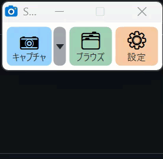

# SimpleCap

Windows 11 用の、シンプルで軽快な画面キャプチャ&注釈ツールです。
外部ライブラリを使わない、インストール不要の小さなアプリです(exe 1 つ、約 300KB)。

## ダウンロードと起動

1. [Releases](https://github.com/onboard-dev/SimpleCap/releases) から最新の `SimpleCap-vX.Y.Z.exe` をダウンロードします。
2. ダウンロードした exe をダブルクリックして起動します(インストールは不要です)。
   - 「Windows によって PC が保護されました」と出たときは、「詳細情報」→「実行」で起動できます。

初めてキャプチャしたときに保存先フォルダを選びます(既定は `ピクチャ\SimpleCap`)。あとから ⚙️ 設定 で変更できます。設定は `%APPDATA%\SimpleCap\settings.ini` に保存されます。
保存されるのは、合成済みの `.png` と、レイヤ情報つきの `.scap` の2つです。

## キャプチャウィンドウ

-

| ボタン | 動作 |
|---|---|
| 📷 キャプチャ | クリックするとウィンドウ、ドラッグすると任意の範囲をキャプチャします。Esc か右クリックでキャンセル。ボタン右端の「⌄」を押すと、撮り方(画面・範囲 / 📜 スクロール / 🎥 ビデオ録画)を選ぶメニューが出ます。選んだ撮り方は覚えておき、ボタンの絵・名前・色が変わって、次回からボタン本体でその撮り方になります(次に起動したときも同じ) |
| 🗂️ ブラウズ | ファイルブラウズ・編集画面を開く |
| 📜 スクロール | 縦に長いページをスクロールしながらキャプチャ。クリック=ウィンドウ、ドラッグ=範囲を選ぶと開始 → マウスホイールで下へスクロール →「■ キャプチャ終了」で 1 枚の縦長画像にしてブラウズ画面へ(「✖ 中止」で取りやめ)。|
| 🎥 ビデオ| 画面をビデオで録画(15fps)。キャプチャと同じく、クリック=ウィンドウ、ドラッグ=範囲を選ぶと開始。範囲の周りに赤い枠と「■ 停止」バーが出ます(どちらも録画には写りません)。もう一度押す・停止バー・ホットキー(既定 Ctrl+Shift+PrintScreen)で終了。⚙️ 設定の「マウスカーソルも写し込む」が反映されます。⚙️ 設定の「ビデオキャプチャのときのカウントダウン」(なし / 3 / 5 / 10 秒)を選ぶと、範囲を選んだあと数えてから録画を始めます(数えている間もふつうに操作でき、バーの「✖ 中止」で取りやめ) |
| ⚙️ 設定 | 設定ウィンドウを開く(下記の「キャプチャの動作」、ショートカットキー、保存先) |

キャプチャウィンドウはタイトルバーのない、ボタンだけの小さなウィンドウです。

- 左端のつまみ(点々)をドラッグすると移動できます。ダブルクリックでアイコンのみの表示に切り替わります。
- 右クリックで「アイコンのみで表示」「システムトレイにしまう」「ブラウズ画面を表示」「設定」「終了」のメニューが出ます。

**⚙️ 設定 →「📷 キャプチャの動作」**

- ⏱️ 3秒後にキャプチャ:3秒待ってからキャプチャ(メニューを開いた状態を撮るとき用)
- 🖱️ マウスカーソルも写し込む
- 📋 キャプチャと同時にクリップボードへコピー
- 🔹 キャプチャウィンドウをアイコンのみで表示(左端のつまみのダブルクリックでも切り替え)
- 📥 キャプチャウィンドウをシステムトレイに入れる:ON にするとキャプチャウィンドウは表示せず、ショートカットキーだけで使います(トレイのアイコンをクリックするとブラウズ画面。ブラウズ画面の「📷 キャプチャ」はそのまま撮影)

- ホットキーは、キャプチャ=**PrintScreen**、ブラウズ画面を表示=**Ctrl+PrintScreen** です(⚙️ 設定で変更可)。キャプチャのキーが他のアプリに使われていて登録できないときは Ctrl+Shift+X になります。
- Windows 11 で PrintScreen を押すと Snipping Tool が起動してしまう場合は、「設定 → アクセシビリティ → キーボード → Print Screen キーを使用して画面キャプチャを開く」をオフにしてください。
- キャプチャウィンドウで Esc を押す(または右クリック →「システムトレイにしまう」)と、システムトレイ(画面右下の通知領域)にしまいます。ホットキーはそのまま使えます。トレイのアイコンをクリックで再表示、右クリックでキャプチャ・ブラウズ・設定・終了のメニューが出ます(メニューの左の青い帯にアプリ名とバージョンを表示)。ブラウズ画面で Esc を押すと、選択の解除のあと、× と同じくキャプチャウィンドウに戻ります(「システムトレイに入れる」設定のときは、最小化してタスクバーに残ります)。
- キャプチャウィンドウとブラウズ画面は、前回終了したときのディスプレイ・位置(ブラウズ画面は大きさと最大化も)で次回も表示します。そのディスプレイが外されていたら、同じ番号かメインのディスプレイに出します。
- ブラウズ画面を最大化すると、「🔲 全体」と同じく表示中の画像・ビデオをウィンドウいっぱいに合わせます。
- 画面はいつも1つだけ表示します。起動直後はキャプチャウィンドウ、キャプチャするとブラウズ画面に切り替わります。
- ブラウズ画面の「📷 キャプチャ」か × で、キャプチャウィンドウに戻ります。アプリの終了は、キャプチャウィンドウかトレイのアイコンを右クリック →「✖ 終了」です。
- ショートカットキーは、キャプチャウィンドウかブラウズ画面右上の「⚙️ 設定」で変更できます(既定:キャプチャ=PrintScreen、ブラウズ画面=Ctrl+PrintScreen)。

## 設定のエクスポート / インポート

⚙️ 設定ウィンドウの左下の「📤 エクスポート…」「📥 インポート…」で、設定をファイル(.ini)に書き出したり、読み込んだりできます。別のパソコンへの引っ越しやバックアップに使えます。

- 書き出すのは「保存」済みの設定です(ショートカットキー、キャプチャの動作、ビデオ、AI の URL・モデル、ウィンドウの位置、スタンプの表示など)。
- AI のシークレットキーは書き出しません(暗号化されていて、ほかのパソコンでは使えないため)。読み込んでも今のキーはそのまま残ります。
- 読み込むと SimpleCap の再起動を確認します。再起動すると読み込んだ設定が反映されます。
- 書き出した保存先フォルダがそのパソコンに無いときは、保存先は今のままにします。
- スタンプの画像は含みません(スタンプ設定の「📂 保存フォルダを開く」でフォルダごとコピーしてください)。

## ブラウズ・編集画面

- 下の一覧に、これまでのキャプチャがサムネイルで並びます。
  - 一覧から PowerPoint などへドラッグ&ドロップできます。
  - 右クリックで「コピー」「エクスプローラーで表示」「削除(ごみ箱へ)」が使えます。
  - 一覧で選んで Ctrl+C(または右クリック→コピー)すると、エクスプローラーにはファイルとして、Word や PowerPoint には画像として貼り付けられます。
  - 一覧で選んで Delete キーを押すと、ごみ箱へ移動します(確認あり)。
  - Ctrl+A ですべて選択、Shift+クリックで範囲選択、Ctrl+クリックで1つずつ追加選択できます。複数選んでコピー・削除・ドラッグもできます。
- 保存ファイルについて
  - `.png` … 注釈を合成した完成画像。一覧に表示され、ほかのアプリでもそのまま使えます。
  - `.scap` … 注釈をレイヤのまま保存した編集用データ(同じ名前の .png とペア)。これがあると、あとから矢印や文字を動かせます。
  - `.scap` がなくても `.png` は開けます(注釈は背景に合成済みの状態)。`.png` を消すと一覧に出なくなります。
- 左のツールは次のとおりです。
  - ⬚ 選択(点線の四角形のアイコン)。ほかのツールで描いたあとに画像の上で右クリックすると、選択を外して「選択」に戻ります
  - ➡️ 矢印
  - ➖ 線
  - ⬜ 四角
  - ⭕ 楕円
  - 🔤 文字
  - 💬 吹出し(引き出し線つき。矢印の先のハンドルで指し先を移動)
  - 👉 矢印型(右→左にドラッグすると左向き)
  - 🔢 番号スタンプ(クリックするたびに 1, 2, 3 … と増える)
  - 📍 ピン(番号のピン型。ドラッグした方向に先端が向く)
  - 🖍️ 蛍光ペン
  - ▦ モザイク
  - ✂️ 切抜き
  - ↕️ 縦カット(マウスの位置に横の点線が出ます。上下にドラッグした範囲が半透明のグレーになり、離すとその範囲を切り取って上下を詰めます。注釈も一緒に詰まります。Ctrl+Z で元に戻せます)
  - ↔️ 横カット(縦の点線が出ます。左右にドラッグした範囲を切り取って左右を詰めます)
  - 🪣 塗り(クリックした所と似た色の範囲を塗りつぶす。色=塗りの色、透明なら線の色)
  - 🪄 透明化
- 右側の「線/文字の色」「塗りの色」には、最近よく使う3色が並びます(クリックですぐ適用)。
  - スポイト(🖊)をクリックすると、画面上の好きな場所の色を取れます(ルーペ付き、Esc で中止)。
  - ラベル部分をクリックすると、色見本(12色)が開きます。
  - 塗りの色では「⊘ 透明」も選べます。
  - 「🎨 その他の色…」で、見本にない色を指定できます。
  - 色見本を**右クリック**すると、その枠を好きな色に変更できます(次回も残ります)。
- 右側のパネルは、編集画面との境目(仕切り)をドラッグして幅を変えられます。プロパティ部分は入り切らないときスクロールでき、レイヤ部分は下に固定です(プロパティとレイヤの境目をドラッグして高さを変更)。幅と高さは次回も残ります。
- 右側でプロパティを変えられます。
  - 変えられるのは、線の色、塗りの色、塗りの不透明度(0 にすると透明)、太さ、文字サイズです。
  - 図形を選択しているときは、その図形に反映されます。
- **レイヤ**
  - 注釈は1つずつ別のレイヤになり、あとから移動、変形、削除ができます。
  - ☑ で表示/非表示。見出しの右の ⬆ ⬇ で重なり順、🗑 で削除、🧩統合 でレイヤ統合です。
- **↔️ 始点にも矢印**
  - 右側のチェックを ON にすると、矢印の始点側にも矢じりが付きます(両矢印)。矢印を選んで切り替えるか、矢印ツールを選んだ状態で ON にすると次から両矢印で描けます。
- **🌟 スタンプ**
  - 左のツールバーの「🌟 スタンプ」でスタンプウィンドウを開閉します。グループを選び、スタンプをクリックすると表示中の範囲の中央に新しいレイヤとして貼り付けます(元の大きさで貼り、キャプチャ画像の短い辺の半分を超えるときは縮めます。大きさは貼ったあとハンドルで調整)。「サムネイル」で一覧の大きさを 25〜300% から選べます。スタンプウィンドウの右端のハンドルをドラッグすると幅を広げられます。
  - 右上の ⚙ でスタンプの設定を開きます。グループの追加・名前変更・削除、ダウンロード先(Webページの URL)の指定、登録済みスタンプの削除、ファイルからの追加ができます。
  - グループ一覧の下の「📁 フォルダから…」「🗜 zip から…」で、フォルダや zip から新しいグループを作れます。中の PNG / JPEG 画像だけをコピーします(フォルダはサブフォルダも対象。1 ファイル 50MB まで)。
  - 「⬇ ダウンロード」で、そのページ内の PNG / JPEG 画像を探して一覧表示し、☑ を付けたものを登録します。素材サイトの利用規約を確認してから使ってください。
  - スタンプは `%APPDATA%\SimpleCap\stamps\<グループ名>` に保存されます。設定ウィンドウの「📂 保存フォルダを開く」でこのフォルダを開けます。フォルダごとコピーすればバックアップになります(戻すときは SimpleCap を終了してから戻す)。
- **線の種類**
  - 右側の「線の種類」で、実線・細かなドット・短い破線・長い破線を選べます。
  - 矢印・線・四角・楕円は線そのもの、吹き出しは引き出し線と箱の内側の枠、文字と矢印型は枠が点線になります。
- **サイズの記憶**
  - 注釈の太さ・線の種類・文字サイズ・番号の大きさ・吹き出しの大きさを変えると、そのツールの次回の既定になります(ツールごとに記憶、次回起動後も有効)。
- **範囲選択(背景画像)**
  - 選択ツールで、何もない所からドラッグすると点線の範囲選択になり、四隅のアンカーで範囲を調整できます。
  - 範囲の中をドラッグすると、その部分を同じレイヤ(背景)の中で移動します。元の場所は透明になります。
  - Ctrl+X で切り取り(元の場所は透明に)、Ctrl+C でコピー、Ctrl+V でその位置に新しいレイヤとして貼り付け、Delete で透明にします。
  - 範囲の上で右クリックすると「新しいレイヤにコピー」「切り取って新しいレイヤへ」も選べます。
- **画像サイズの変更(キャンバス)**
  - 選択ツールで画像の何もない所をクリックすると、四隅と四辺にアンカーが出ます。
  - ドラッグで画像サイズを変えられます。広げた部分は透明になり、縮めると切り取られます。
- **許容範囲(トレランス)**
  - 右側の「塗り・透明化の許容範囲 %」で、🪣塗り と 🪄透明化 がどこまで似た色をまとめて扱うかを指定します。
  - 0 は同じ色だけ。数値を上げると、グラデーションやにじんだ色もまとめて処理します。
- **🧩 レイヤ統合**
  - 表示中のレイヤをすべて背景画像レイヤに統合します。
  - Ctrl+Z で元に戻せます。
- **透明色対応**
  - PNG の透明を保ったまま保存、コピー、書き出しができます。
  - 🪄 透明化 でクリックした色を透明にできます。
  - 編集中の画面では、透明な部分が市松模様で表示されます。

### ショートカット

| キー | 動作 |
|---|---|
| Ctrl+Z / Ctrl+Y | 元に戻す / やり直し |
| Ctrl+C / Ctrl+V | 合成画像(範囲選択中はその範囲)をコピー / 画像を新しいレイヤとして貼り付け |
| Ctrl+X | 範囲選択(または選択中の注釈)を切り取り |
| 注釈を選んで Ctrl+C → Ctrl+V | 選んだ注釈だけをコピー。SimpleCap 内では編集できる注釈として少しずらして貼り付け、他のアプリには注釈だけの透明 PNG として貼り付け |
| Ctrl+S / Ctrl+Shift+S | 保存 / 書き出し(PNG・JPG・BMP) |
| Ctrl+ホイール | 拡大・縮小(上のバーの「🔲 全体」の横の欄で倍率を数値指定もできます。数字を入力して Enter) |
| ホイール(注釈を選択中) | 線の太さ / モザイクの粗さを 1 ずつ変更(上で太く、下で細く)。連続操作は Ctrl+Z 1 回で戻せます |
| Delete / 矢印キー | 選択レイヤを削除 / 5px ずつ移動(Ctrl か Shift+矢印キーで 1px ずつ) |
| ドラッグで移動 | スマートガイド:他の注釈やキャンバスの端・中央、等間隔の位置に吸着し赤い補助線・矢印を表示。Alt を押しながらドラッグで吸着しない |
| V A L R E T H M C | ツールの切り替え(選択・矢印・線・四角・楕円・文字・蛍光・モザイク・切抜き) |
| B W | 吹き出し(引き出し線・矢印型)。ダブルクリックで文字を編集 |
| F | 🪣 塗り |
| N P | 番号スタンプ(丸・ピン型)。大きさ=文字サイズ、ダブルクリックで番号を変更 |
| Shift + ドラッグ | 45°に固定 / 正方形・正円 |

**⏱️ 最大録画時間**(⚙️ 設定、既定 10 分):この時間になるとビデオ録画を自動で止めて保存します(録画中のバーに「録画中 00:12 / 10分」と表示)。

**🎥 ビデオのクリック表示**(⚙️ 設定、「マウスカーソルも写し込む」が ON のときだけ)

- 左クリック・右クリック・ダブルクリックを、色の違う広がる輪で録画に描き込みます(ダブルクリックは二重の輪)。輪の内側は、縁から中心に向かって透明になるグラデーションで塗られます。ボタンを押している間はカーソルの下に丸が出ます。
- 「輪の広がるスピード」は 1(遅い)〜 5(速い)から選べます。広がりきるまでの時間は 1=3 秒、2=2 秒、3=1.5 秒(ふつう)、4=1 秒、5=0.6 秒で、そのあと約 0.4 秒で薄くなって消えます。
- 「⏸️ マウスクリック時に静止する」を ON にすると、クリックから約 0.36 秒後の画面を止めて、選んだ秒数(1〜5 秒)だけビデオに足します。止めている間も輪は同じスピードで広がり続けます(静止の長さで輪の速さは変わりません)。録画は止まらず、そのぶんビデオが長くなります。ダブルクリックは 2 回目のときだけ静止します。
- 「🔍 クリック位置を拡大」を ON にすると、クリックした所を中心に画面を拡大します(拡大率 10〜50%)。クリックの瞬間から拡大を始め、静止が始まる時点(約 0.36 秒後)までに拡大しきります。輪が消え、静止も終わってから元の大きさに戻ります。輪の表示が OFF でも拡大だけ使えます。
- 「左 / 右 / ダブル」の文字の表示、大きさ(小・中・大)、それぞれの色を変えられます。

## ビデオの編集と書き出し

録画したビデオは一覧に「🎥」付きで並び、選ぶとブラウズ画面がビデオ編集に切り替わります。

| 操作 | 動作 |
|---|---|
| Space / 映像をクリック | 再生・一時停止 |
| ← → (Shift で 1 秒) / Home / End | コマ送り / 先頭・末尾へ |
| タイムラインをクリック・ドラッグ | その位置へ移動 |
| I / 「[ IN」 | IN 点(ここから使う) |
| O / 「OUT ]」 | OUT 点(ここまで使う)。IN を置かずに押すと、前の区間の続き(または先頭)から |
| 区間の一覧 / Delete | 区間を選ぶとその IN へ移動、Delete か「🗑 区間を削除」で削除 |
| 区間だけ再生 | IN〜OUT の区間だけをつないで再生(出来上がりの確認) |
| 🎬 生成… / Ctrl+S / 右クリック | IN〜OUT の区間だけをつないだ MP4 か GIF を作る(区間がなければ全体) |

- **✏️ 注釈**:押すと映像の場所がキャンバスになり、画像と同じツール(矢印・線・四角・文字・吹出し・番号・蛍光・ぼかし・スタンプなど)で書き込めます。もう一度押す(「✔ 注釈を終了」)と編集を終わります。
  - 注釈はふだんビデオ全体に表示されます。注釈を選んで、下の「ここから」「ここまで」「全体」で表示するコマの範囲を決められます(タイムラインに青い帯で表示)。
  - 編集中のコマ送りは PageUp / PageDown かタイムライン、Space で再生。範囲外の注釈は隠れます。
  - 注釈は書き出す MP4 / GIF に焼き込まれ、一覧のサムネイルにも表示されます。元のコマ画像は変わりません(切抜き・縦カット・横カット・塗り・透明化はビデオでは使えません)。
- IN / OUT は何組でも置けます。重なった区間は自動でまとめます。区間は自動保存されます。
- 書き出した MP4 / GIF を保存先フォルダに保存すると、一覧に別の項目(🎬 MP4 / 🎞️ GIF)として追加されます。GIF はサムネイルも、選んだときの表示もアニメーションします。MP4 は選ぶと 1 コマ目を表示し、下の「▶ 再生 / ⏸ 一時停止」「■ 停止」(Space でも可)で再生します(Windows Media Player の部品を使用。使えない環境では既定のアプリで開きます)。元のビデオ(🎥)は IN / OUT を残したまま、何度でも書き出せます。
- GIF / MP4 は Ctrl+C でファイルとしてコピーできます(エクスプローラーや Teams などに貼り付け)。
- **🔗 結合**:下の一覧でビデオ(🎥)・GIF・MP4 を 2 つ以上選ぶと(Ctrl+クリック / Shift+クリック)、ビデオ編集の右上に「🔗 結合」ボタンが出ます(一覧の右クリックメニューにも出ます)。押すと、選んだものを一覧の並び順に 1 本につないで、保存先フォルダに `日時_結合.mp4` を作り、一覧に追加します。
  - ビデオ(🎥)は IN / OUT の区間と注釈を反映します(「🎬 生成」と同じ)。
  - 大きさは最初のものに合わせます。大きさや縦横比が違うものは縮めて、余白は黒になります。音声は入りません。
  - 選んだものがすべて GIF のときは `日時_結合.gif` を作ります。
- MP4 / GIF の作成には **ffmpeg** を使います。初めて書き出すときに確認のうえ自動でダウンロードします(約 100MB、`%APPDATA%\SimpleCap\ffmpeg` に保存)。ネットにつながらない環境では、ffmpeg.exe をそのフォルダか SimpleCap.exe と同じフォルダに置いてください。
- 録画データは保存先フォルダの `日時.scvid` フォルダに連番 JPEG で入っています(1080p で 1 秒あたり約 1〜2MB)。

- 下のサムネイル一覧は、上端の灰色のハンドルを上下にドラッグすると高さを変えられます(次回も同じ高さ)。

## AI で名前付け

ブラウズ画面の左のツールバー(🌟 スタンプの下)の「🏷️ 名前付け」(または一覧の右クリック →「🏷️ AI で名前付け」)で、選んだ画像・ビデオ・GIF・MP4 に AI が名前を付け、ファイル名に反映します。一覧で複数選ぶとまとめて付けます。

- AI には画像(ビデオ / GIF / MP4 は 1 コマ目)を「この画像に合ったファイル名を20文字以内で付けてください」というプロンプトと一緒に送ります(長い辺 1568px までに縮小した JPEG)。
- ファイル名は「日時_AIの名前.png」のように、先頭の日時を残して付けます(一覧の並び順を保つため)。一覧には「日付 + 名前」で表示されます。
- 使う AI は ⚙️ 設定の「🤖 AI で名前付け」で、OpenAI / Claude / OpenRouter(既定モデル google/gemini-2.5-flash-lite)から選び、それぞれ API の URL・シークレットキー・モデルを入力します(シークレットキーはこのパソコンのこのユーザーだけが読める形で暗号化して保存)。
- 画像を外部の AI サービスに送るので、個人情報や業務上の機密が写った画像には使わないよう注意してください。

## 注意事項

- 絵文字は、WinForms(GDI)の制約でモノクロ表示になります。
- 高 DPI(Per-Monitor V2)に対応しているので、拡大率の違うマルチモニターでも正しい範囲をキャプチャできます。
- 個人情報の扱いは [プライバシー ポリシー](PRIVACY.md) をご覧ください。
